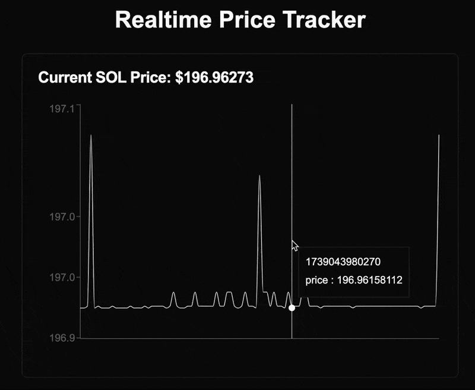

#### 🔴 Problems with Finance

- **Slow Settlement** – Transactions take days to finalize due to intermediaries.
- **Opaque Systems** – Users rely on centralized entities with limited visibility.
- **Limited Composability** – Financial platforms operate in silos, restricting innovation.

#### ⛓️ Current Blockchain Limitations

- **High Latency** – Transactions take seconds or minutes to confirm.
- **Scalability Issues** – Congestion leads to high gas fees and slow execution.
- **Off-Chain Dependencies** – Many DeFi platforms rely on centralized price oracles.

#### ⚡ MagicBlock's Solution

- **Real-Time Settlement** – Transactions finalize instantly with low latency.
- **Fully Transparent** – Programs provide auditable, tamper-proof execution.
- **Seamless Composability** – Financial applications interconnect permissionlessly.

## Example: Ultra-Low Latency DeFi

<CardGroup cols={2}>
  <Card
    title="Source Code: Real-Time Pricing Oracle"
    icon="github"
    href="https://github.com/magicblock-labs/real-time-pricing-oracle"
    iconType="duotone"
  >
    Learn more about building and integrating DeFi with MagicBlock!
  </Card>
  <Card
    title="Pyth Price Data Demo"
    icon="dollar-sign"
    href="https://pyth-template.magicblock.app/"
    iconType="duotone"
  >
    Try out our live demo showcasing Pyth price data streams with MagicBlock
  </Card>
</CardGroup>
